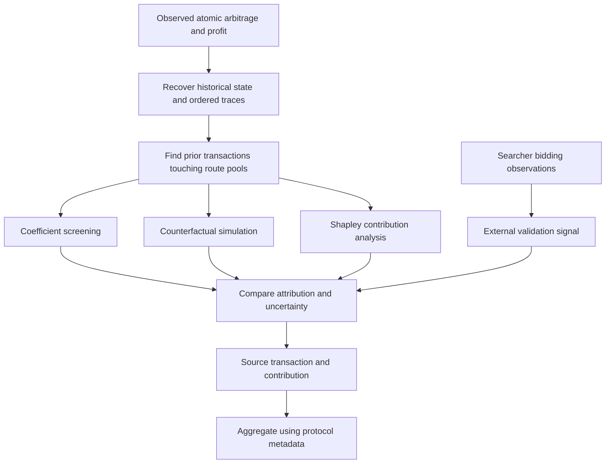

# Where does an arbitrage opportunity come from?

### A reading guide to *The Origins of MEV: Systematic Attribution of Arbitrage Opportunity Creation at Scale*

**Research by Andrei Seoev, Dmitry Belousov, Anastasiia Smirnova, Ksenia Kurinova, Aleksei Smirnov, Denis Fedyanin, and Yury Yanovich.**

[Paper v1](https://arxiv.org/abs/2604.27979v1) · [Official PDF](https://arxiv.org/pdf/2604.27979v1) · [HTML](https://arxiv.org/html/2604.27979v1) · [Citation](references/paper.bib) · [Source and rights](SOURCES.md)

An unofficial reading companion maintained under `0xHayd3n`, explaining the **14-page preprint submitted on April 30, 2026**, arXiv **2604.27979v1**. The research, methods, experiments, and reported findings belong to the seven authors above. No author affiliation or endorsement is implied.

**Status: documentation only.** This repository does not implement the attribution system or reproduce the study. It contains explanatory notes, selected reported results, machine-readable metadata, and a documentation validator. The paper PDF, full extracted text, figures, bot logs, and blockchain datasets are linked or described rather than redistributed.

## The question in one minute

An arbitrage transaction captures a price imbalance. A preceding swap may have created it. Measuring the extractor's profit does not, by itself, identify the action that made that profit possible.

Seoev and colleagues start from an **observed atomic arbitrage event**, recover earlier transactions touching the same liquidity pools, and compare ways of assigning responsibility for the opportunity. Their methods range from a fast price-coefficient proxy to counterfactual state replay and a Shapley allocation that can assign positive and negative contributions. The practical recommendation is a hierarchy: screen cheaply, use simulation for the main analysis, and spend Shapley computation on disagreements or suspected multiple contributors. Bot observations provide a separate validation signal when available. [§§3–4, PDF pp. 4–7](https://arxiv.org/pdf/2604.27979v1#page=4).

The guide's interpretation: **creation and extraction are different units of analysis**. A transaction that creates an opportunity can coexist with transactions that amplify it, consume part of it, or leave profit already present at the start of the search window. Choosing one primary source summarizes that structure; it does not prove every other contribution is zero.

## Choose a reading route

| Your goal | Start with | Then read |
| --- | --- | --- |
| Understand the argument quickly | This README | [Reading map](notes/01-reading-map.md) |
| Follow the mathematics and algorithms | [Methods and notation](notes/02-methods.md) | [Glossary](notes/07-glossary.md) |
| Assess the empirical evidence | [Reported results](notes/03-results.md) | [Limitations and discrepancies](notes/04-limitations.md) |
| Understand the visual evidence | [Figure and table guide](notes/06-figures-and-tables.md) | Linked official PDF pages |
| Plan an independent reproduction | [Reproduction requirements](notes/05-reproduction.md) | [Source record](SOURCES.md) |
| Ask an agent about the paper | [AGENTS.md](AGENTS.md) | [metadata.json](metadata.json), [llms.txt](llms.txt), [results data](data/results.json) |
| Cite or reuse the guide | [Attribution](ATTRIBUTION.md) | [CITATION.cff](CITATION.cff), [licence](LICENSE.md) |

Page references use the PDF's 1-based pages, which match the printed page numbers. All section, table, figure, and algorithm labels refer to **v1**.

## How attribution works



*Original explanatory diagram of the paper's design, based on §§3–4 and 6. These are conceptual stages; no executable pipeline is supplied here.*

The formal setup fixes an arbitrage transaction and its route. Historical state evolves in canonical transaction order, and candidate source transactions precede the event and interact with its pools. Contributions plus a baseline component account for the observed profit. The baseline matters: an opportunity already present at the chosen starting state should not automatically be attributed to a transaction inside the window. The stated Polygon search limit is 100 preceding blocks. [§3, p. 4; §4.3.2, pp. 5–6](https://arxiv.org/pdf/2604.27979v1#page=4).

| Method | Evidence used | What it contributes | Main qualification |
| --- | --- | --- | --- |
| Bot data | Searcher bidding decisions and predicted routes | A real-time signal of the transaction a searcher intended to target | Proprietary observations; intent can differ from finalized outcomes |
| Simulation | Historical state, traces, and replayed arbitrage profit | A primary source selected by the largest positive marginal impact in a searched interval | Requires replay fidelity; v1 pseudocode has threshold/indexing ambiguities |
| Coefficient / K-value | Pool prices or reserves along the fixed route | A cheap ranking by change in a price multiplier | Omits finite-trade depth, slippage, and fees; ranking is not a dollar allocation |
| Shapley | Profit evaluated for candidate coalitions | Contributions accounting for interactions, including negative contributions | Depends on the coalition game and replay semantics; exact enumeration is expensive |

This table paraphrases [§4.3 and Table 1, pp. 5–7](https://arxiv.org/pdf/2604.27979v1#page=5). The [methods note](notes/02-methods.md) explains the formulas, implementation assumptions, and differences between paper prose and pseudocode.

## What the authors evaluated

Keep the two Polygon datasets separate. [§5.1, pp. 7–8](https://arxiv.org/pdf/2604.27979v1#page=8).

| Dataset | Block range, inclusive | Reported atomic arbitrage events | Purpose |
| --- | --- | --- | --- |
| March 2–29, 2026 | 83,770,001–84,820,000; **1,050,000 blocks** | **360,026**, with **$334,799** extracted value | Large-scale attribution and distribution analysis |
| February 4, 2026; near 12 hours | 82,546,747–82,567,395 | **2,526** | Method comparison, validation, and single-source analysis |

The paper reports internal MATIC accounting and USD values at execution-time oracle prices. Its implementation uses a modified Geth archive node, Rust/C++ components and Python analysis, with 32-core, 128 GB machines described in the setup. Those are the authors' infrastructure details, not dependencies of this repository. [§5.1, p. 8; §6, p. 11](https://arxiv.org/pdf/2604.27979v1#page=8).

## Reported findings, with their scope

**All experimental values below are paper-reported. No experiment was run by this guide.**

- **Dominant source:** in the **February comparison dataset**, 96.7% of events have one transaction accounting for **more than 70% of positive Shapley value**. This describes dominance under the paper's attribution model, not exactly one nonzero cause. The paper also identifies 83 tied-maximum events (3.3%). [§5.3, pp. 8–9](https://arxiv.org/pdf/2604.27979v1#page=8).
- **Simulation as the main practical method:** Table 2 reports 91.7% accuracy, 99.1% coverage, and a mean of 12.3 ms/event on the February comparison. Accuracy is relative to the authors' triangulated reference, which combines signals that can share errors. [§§5.2–5.4, pp. 8–9](https://arxiv.org/pdf/2604.27979v1#page=8).
- **Protocol participation:** §5.5 reports Uniswap V3 58.0%, Algebra 29.6%, Uniswap V4 28.9%, Uniswap V2 23.2%, and DODO 8.2%. A source transaction can interact with multiple AMMs. These are overlapping participation frequencies, **not mutually exclusive market shares or shares of MEV dollars**. The population label and counts in this paragraph are inconsistent elsewhere in v1; use them with the [recorded qualifications](notes/04-limitations.md). [§5.5, p. 9](https://arxiv.org/pdf/2604.27979v1#page=9).

Selected comparison values from Table 2, p. 9:

| Method | Reported accuracy | Reported coverage | Reported mean time / event |
| --- | --- | --- | --- |
| Bot data | 94.2% | 38.4% | 8 ms |
| Simulation | 91.7% | 99.1% | 12.3 ms |
| Coefficient | 77.2% | 88.4% | 0.8 ms |

**Reading the denominator matters.** §5.4 describes the coefficient figure as agreement with simulation, while Table 2's caption describes accuracy against triangulated ground truth. Bot coverage is constrained by what the searcher observed. Do not treat these as a common, complete, independently verified causal benchmark. Shapley rows and all source conflicts are retained in the [full results note](notes/03-results.md) and [machine-readable record](data/results.json).

## Qualifications that change the reading

The source is internally inconsistent in several places. This guide records the discrepancy without selecting an invented correction:

| Issue | What v1 says | How to read it here |
| --- | --- | --- |
| Shapley coverage | §5.2: exact 12.0%, Monte Carlo 100%; Table 2: 98.1% for each | Keep both reports; coverage is unresolved |
| End-to-end runtime | §5.4: about 80 hours for March and 12.3 ms/event | Multiplying 360,026 by 12.3 ms gives about **73.8 minutes**, excluding other work; the paper does not reconcile the scopes |
| Creator population | §5.5 calls 220,262 creators a February dataset; §5.1 has 2,526 February events; Figure 6 legend says 220,264 | Do not silently relabel the population or infer a settled count |
| Concentration unit | Figure 6 mixes transaction, arbitrageur, and address descriptions | Avoid a precise wallet-concentration claim from that figure |
| Complexity and implementation | Table 1 labels coefficient O(1); Algorithm 2 iterates over candidates; Algorithm 1 has unclear indexing/threshold behavior | Explain the design; do not treat pseudocode as validated software |

See [limitations and source discrepancies](notes/04-limitations.md) for additional count, convergence, and conclusion-level qualifications. The runtime multiplication above is **companion arithmetic**, not a new timing experiment.

The authors acknowledge triangulated ground truth, one-chain evaluation, and restriction to atomic arbitrage. Shapley fairness applies to the chosen game; deterministic execution alone does not settle coalition order, invalid transaction treatment, or whether the fixed route would be optimal in every counterfactual. Reported Monte Carlo stabilization on selected cases is not a universal error guarantee. [§§4.3.4, 5.2–5.6, pp. 7–10](https://arxiv.org/pdf/2604.27979v1#page=7); companion analysis in [methods](notes/02-methods.md) and [limitations](notes/04-limitations.md).

## Read with an agent

Start with [AGENTS.md](AGENTS.md). Use [metadata.json](metadata.json) to identify the pinned source and [llms.txt](llms.txt) to select a note. Check exact numbers in the cited PDF page before using them in an important claim.

Example request:

> Read AGENTS.md and the results and limitations notes. Explain what the 96.7% statistic means, which dataset it comes from, and why it does not establish exactly one causal transaction. Cite the v1 section and page, separate author-reported evidence from interpretation, and state that this guide did not reproduce the experiment.

No API key, wallet, node, or trading setup is needed to read or validate this guide. The [reproduction checklist](notes/05-reproduction.md) describes what an independent research effort would need. The authors say retrospective components **will be released upon publication**; proprietary bot logs will not be released. No author-designated code URL was identified in the v1 PDF or arXiv record checked for this guide. [§6, p. 11](https://arxiv.org/pdf/2604.27979v1#page=11); [bounded source check](SOURCES.md).

## Attribution and citation

Please cite **Seoev, Belousov, Smirnova, Kurinova, Smirnov, Fedyanin, and Yanovich (2026)** for the research. [CITATION.cff](CITATION.cff) makes the paper the preferred citation; [BibTeX](references/paper.bib) links to v1. The DOI [10.48550/arXiv.2604.27979](https://doi.org/10.48550/arXiv.2604.27979) identifies the work; the versioned arXiv URL pins this guide's source. The PDF's incomplete conference template is not evidence of SIGCOMM acceptance.

The paper is listed under **CC BY 4.0** on its [arXiv record](https://arxiv.org/abs/2604.27979v1). This guide's explanatory prose, diagrams, and selected data are adaptations and commentary with credit under [CC BY 4.0](LICENSE.md); its original validator code is [MIT-licensed](LICENSE-CODE). Neither licence implies author endorsement. See [ATTRIBUTION.md](ATTRIBUTION.md) for the rights boundary and [SOURCES.md](SOURCES.md) for source verification and the attachment-transfer limitation.

## Validate and contribute

```sh
python scripts/validate.py
```

The validator checks documentation links, metadata, citation identity, and publication hygiene. It does not replay Polygon, measure attribution accuracy, or validate the authors' experimental results. See [CONTRIBUTING.md](CONTRIBUTING.md) before changing claims or moving to a later paper version.
